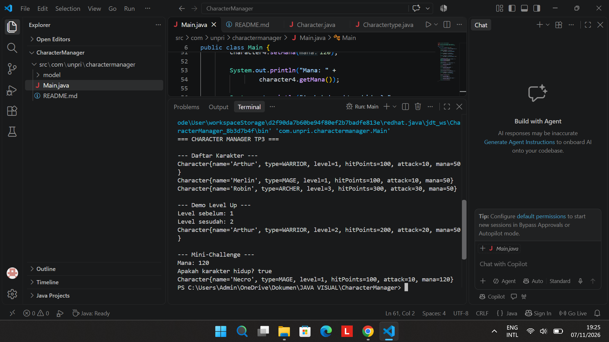
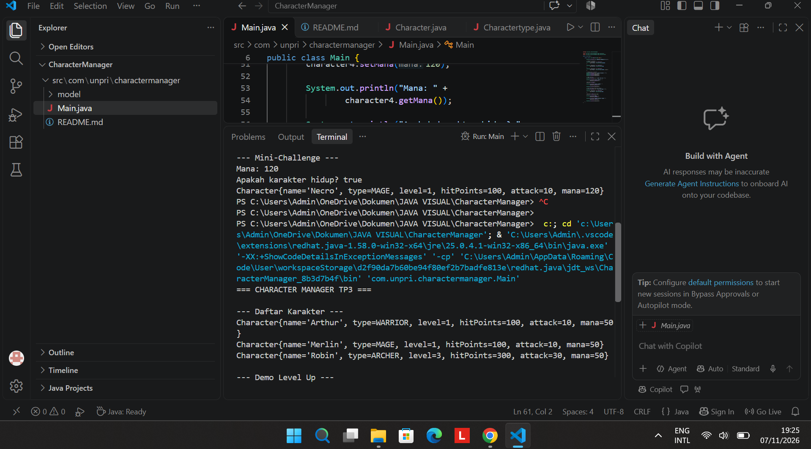
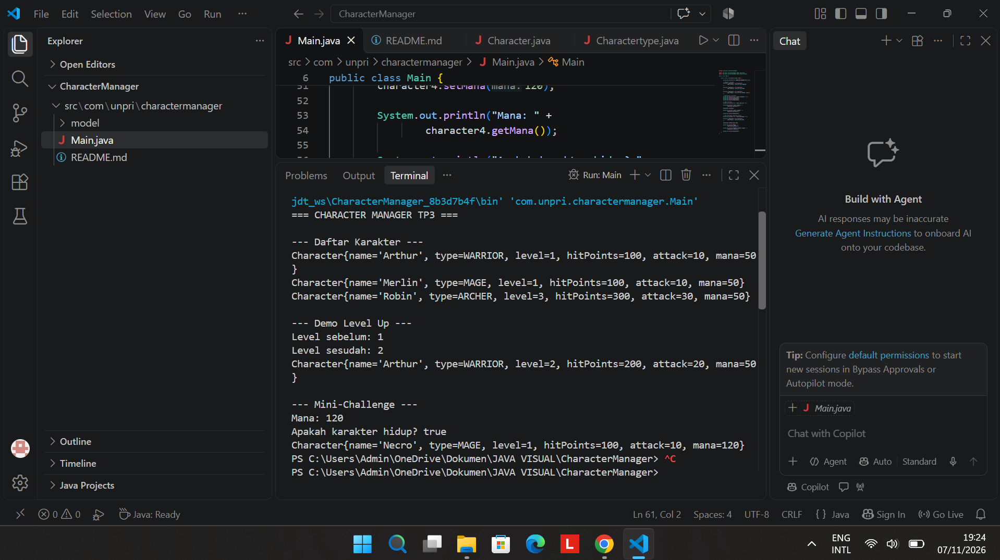
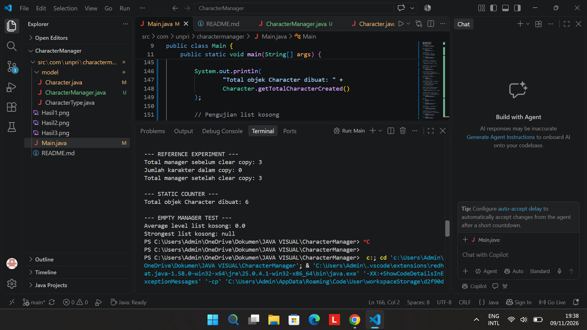
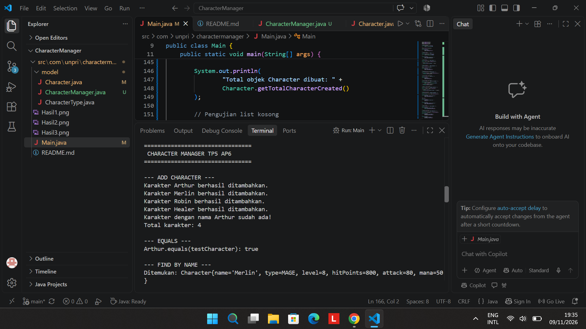
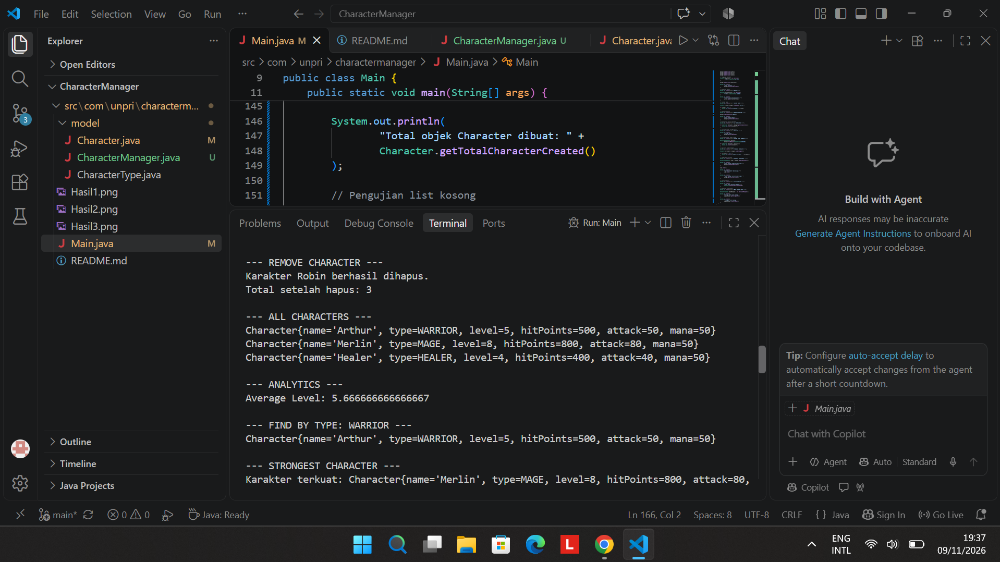

# Character Manager — TP3 (Java Visual SIH-6406)

## Deskripsi
Project Character Manager merupakan program Java sederhana yang digunakan untuk mengelola data karakter dalam sebuah game. Project ini menerapkan konsep class, object, constructor, enum, encapsulation, getter, setter, dan method. Pada tugas ini juga ditambahkan fitur mana dan pengecekan status hidup karakter.

## Fitur
- Membuat karakter menggunakan dua constructor.
- Menggunakan enum CharacterType untuk menentukan jenis karakter.
- Menggunakan getter dan setter untuk mengakses atribut.
- Melakukan level up dengan memperbarui HP dan attack.
- Menambahkan atribut mana dengan validasi nilai negatif.
- Mengecek status karakter menggunakan method isAlive().
- Menampilkan informasi karakter menggunakan toString().

## Screenshot Output

![Output Character Manager]   
## Struktur Folder

```text
CharacterManager/
├── src/
│   └── com/
│       └── unpri/
│           └── charactermanager/
│               ├── model/
│               │   ├── Character.java
│               │   └── CharacterType.java
│               └── Main.java
├── screenshot/
│   └── output.png
└── README.md
```

## Identitas Mahasiswa

- Nama: [Rahmat Hinsah Suya Putra]
- NIM: [253303621251]
- Mata Kuliah: Java Visual
- Tugas: TP3 AP3 Character Manager Sprint #1

## Google Docs

Link Analisis Desain dan Ekosistem Java:

https://docs.google.com/document/d/1Oa6fH4OMlWYu9dQ9HGzbVMp7Wm_wkmgGlA37yg_No-w/edit?usp=sharing


======================================================================


# Character Manager — Java Visual SIH-6406

## TP3 — Sprint #1
Implementasi dasar Character Manager menggunakan Java dengan class, object, constructor, enum, encapsulation, getter, setter, level up, mana, dan isAlive().

## TP5 — Sprint #2
Pada tugas TP5, project Character Manager dikembangkan dengan menambahkan pengelolaan karakter melalui class CharacterManager. Fitur yang ditambahkan meliputi:

- equals() untuk membandingkan karakter berdasarkan nama.
- addCharacter() untuk menambahkan karakter.
- findByName() untuk mencari karakter.
- removeCharacter() untuk menghapus karakter.
- getTotalCharacters() untuk menghitung karakter.
- getAllCharacters() untuk mengembalikan salinan ArrayList.
- getAverageLevel() untuk menghitung rata-rata level.
- findByType() untuk mencari karakter berdasarkan jenis.
- findStrongest() untuk mencari karakter dengan attack tertinggi.

### Screenshot TP5

![Output TP5 Character Manager] (  )

### Penjelasan Fitur Analitik

Fitur tambahan yang dibuat adalah findStrongest(). Method ini digunakan untuk mencari karakter dengan nilai attack tertinggi dari seluruh karakter yang tersimpan dalam CharacterManager.

Fitur ini berguna untuk mengetahui karakter yang memiliki kemampuan serangan paling tinggi. Method menggunakan getter getAttack() untuk mengambil nilai attack sehingga atribut tetap terlindungi melalui encapsulation.

Method mengembalikan null jika belum terdapat karakter dalam manager. Dengan demikian, program dapat menghindari error ketika melakukan pencarian pada ArrayList kosong.

### Struktur Folder

```text
CharacterManager/
├── src/
│   └── com/
│       └── unpri/
│           └── charactermanager/
│               ├── Main.java
│               └── model/
│                   ├── Character.java
│                   ├── CharacterType.java
│                   └── CharacterManager.java
├── screenshot/
│   ├── tp3-output.png
│   └── tp5-output.png
└── README.md
```

### Identitas Mahasiswa

- Nama: [Rahmat Hinsah Surya Putra]
- NIM: [253303621251]
- Kelas: [SI PagiB]
- Mata Kuliah: Java Visual

### Google Docs TP3
[https://docs.google.com/document/d/1Oa6fH4OMlWYu9dQ9HGzbVMp7Wm_wkmgGlA37yg_No-w/edit?usp=sharing]

### Google Docs TP5
[https://docs.google.com/document/d/1U3hpXcdxr9esQDYQ1wy4motyVTr7KuZ83ZJXvpA68B4/edit?usp=sharing]
